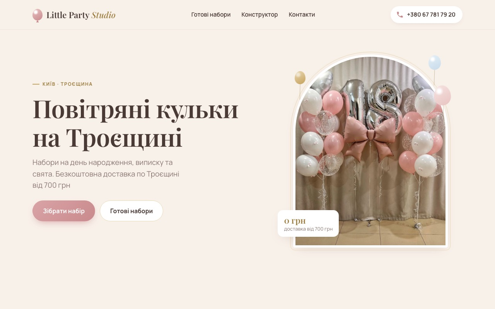

# Little Party Studio — balloon shop demo

A website for a small balloon decoration studio in Troieshchyna, Kyiv. Customers can browse ready-made balloon sets with prices, put together their own set in a builder (with real balloon colours) and send an order request that lands in the studio's Telegram.

**Live site:** https://blessedrbls.github.io/little-party-demo/

> The site UI is in Ukrainian: the client's customers are local.

| Desktop | Mobile |
|---|---|
|  |  |

## Features

- **Ready-made sets.** 90 real photos sorted by category (the same tabs as the studio's Instagram highlights: 1st birthday, boys, newborn, for her, girls, ages, football, surprise box, plus "for him" and gender reveal) with filter tabs, a click-to-zoom lightbox and "from X UAH" prices. Prices come from the client; the first estimates are kept in [`prices-to-confirm.md`](prices-to-confirm.md).
- **Set builder.** Occasion, latex balloons, foil balloons, bubbles with a custom inscription and number balloons (70 or 100 cm, each digit priced separately, several sets of digits in different sizes, with a colour picker from real photos: 11 colours for 70 cm, 21 for 100 cm, one colour for all digits or a different one per digit). The total updates as you go. On mobile it sits in a sticky bottom panel.
- **Balloon colours.** For each latex type (plain, chrome, confetti, agate, brush) and for plain foil stars and hearts (20 colours each) the customer taps colours made from real photos and sets a quantity per colour. The chosen colours go into the order.
- **Printed balloons.** Catalogues of printed latex balloons (30 prints) and printed foil balloons (59 designs). Latex is grouped into newborn, inscriptions and pictures; foil into newborn and "with picture and inscription". Custom inscriptions are offered on foil stars and hearts (balloon price + from 60 UAH), with a colour picker and a text field. Choosing the newborn occasion opens the newborn groups. Bubbles get a "text of the inscription" field too.
- **Delivery.** Free in Troieshchyna from 700 UAH, outside Troieshchyna priced by distance, or pickup at Hradynska St, 7.
- **Date and time.** Orders are taken 07:00–22:00, so the time picker only offers those slots. The date field reminds to order 2–3 days ahead and notes that same-day orders are possible.
- **Orders to Telegram.** Through a small Cloudflare Worker (see [`worker/README.md`](worker/README.md)). Without it the form runs in demo mode.
- **Prices from Google Sheets.** Optional: prices and sets can come from a published Google Sheet (see below).
- **Mobile-first.** Large tap targets, lazy-loaded images, works from 320 px wide.

## Tech

Plain HTML, CSS and vanilla JavaScript. No build step, no backend, no dependencies (Google Fonts only).

```
index.html            page markup
style.css             styles (mobile-first), colours match the logo
script.js             tabs, builder, colour picker, lightbox, order form, sheet loader
data.js               prices, sets, colour palettes, contacts
images/               set photos, logo, favicon
colors/<type>/        balloon colour and print photos (originals), sm/ — thumbnails used on the site
worker/               Cloudflare Worker that forwards orders to Telegram
prices-to-confirm.md  how the set prices were estimated, for the client to confirm
```

To change prices, sets, colours or contacts, edit `data.js`. Two switches live at the top of `script.js`:

| Constant | Empty (default) | Filled in |
|---|---|---|
| `WORKER_URL` | the form shows a demo thank-you, nothing is sent | orders are POSTed to the worker and arrive in Telegram |
| `SHEET_URL` | prices and sets come from `data.js` | prices and sets are loaded from a Google Sheet on top of `data.js` |

## Prices from a Google Sheet

1. Create a Google Sheet with the columns below (first row = headers, exactly these names).
2. **File → Share → Publish to web**, pick the sheet, format **Comma-separated values (.csv)**, **Publish**. Copy the link.
3. Paste it into `SHEET_URL` in `script.js`.

The sheet does not replace `data.js`, it is applied on top of it: a row changes the item with the same `section` + `id`. Empty cells keep the value from `data.js`. If the sheet can't be loaded, the site quietly uses `data.js`.

| Column | What to put there |
|---|---|
| `section` | `latex`, `foil`, `bubble`, `number` or `set` |
| `id` | item id from `data.js`: latex `plain` `chrome` `confetti` `print` `agate` `brush`; foil `heart` `printed` `figure`; bubble `feather` `mirror`; number `70` `100`; set `set-01`…`set-92` (no `set-03`, `set-10`) |
| `name` | new name (for a set — its title) |
| `price` | price in UAH. For a set, an empty cell means "price on request" |
| `from` | `так` to show "from X" (foil, bubbles) |
| `size` | bubble size, e.g. `45–50 см` |
| `image` | sets only: photo path, e.g. `images/set-17.jpg`. Required for a new set |
| `categories` | sets only: `first`, `boys`, `newborn`, `her`, `girls`, `age3`, `age9`, `age10`, `football`, `box`, `him`, `gender`, separated by spaces |
| `occasion` | sets only: `first`, `newborn`, `birthday` or `other` |
| `hidden` | `так` hides the item or set from the site |

Example:

| section | id | name | price | from | size | image | categories | occasion | hidden |
|---|---|---|---|---|---|---|---|---|---|
| latex | plain | | 95 | | | | | | |
| bubble | mirror | | 1500 | | 55–60 см | | | | |
| set | set-01 | | 1800 | | | | | | |
| set | set-02 | | | | | | | | так |
| set | set-17 | Новий набір | 1200 | | | images/set-17.jpg | girls | birthday | |

Colour palettes stay in `data.js`: they come with photos, so adding one means adding a photo to `colors/` anyway.

## Run locally

```bash
python3 -m http.server 5173
```

Then open http://localhost:5173.
