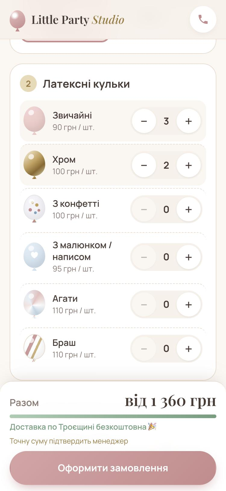

# Little Party Studio — balloon shop demo

A demo website for a small balloon decoration studio in Troieshchyna, Kyiv. Customers can browse ready-made balloon sets, put together their own set in a builder with a live price, and send an order request.

**Live demo:** https://blessedrbls.github.io/little-party-demo/

> The site UI is in Ukrainian: the client's customers are local.

| Desktop | Mobile |
|---|---|
|  |  |

## Features

- **Ready-made sets.** 16 real photos sorted by category (1st birthday, boys, girls, newborn, ceiling) with filter tabs and a click-to-zoom lightbox.
- **Set builder.** You pick the occasion, the latex balloon types, the foil balloons and the number balloons (70 or 100 cm, each digit priced separately). The total updates as you go. On mobile it sits in a sticky bottom panel.
- **Free delivery hint.** Shows how much is left until free delivery (700 UAH). "From" prices get a note that a manager will confirm the final sum.
- **"Build a similar one".** Opens the builder with the occasion preselected and the reference set attached.
- **Order form.** A modal with name, phone, date, time, delivery or pickup, address and comment. The set contents and total are filled in automatically. It validates the fields and shows a thank-you message. Demo only: nothing is sent.
- **Contacts.** Phone links, plus Viber and Telegram buttons.
- **Mobile-first.** Large tap targets, lazy-loaded images, works from 320 px wide.

## Tech

Plain HTML, CSS and vanilla JavaScript. No build step, no backend, no dependencies (Google Fonts only).

```
index.html   page markup
style.css    styles (mobile-first)
script.js    tabs, builder, lightbox, order form
data.js      all prices, sets and contacts
images/      set photos
```

To change prices, sets or contacts, edit `data.js` only.

## Run locally

```bash
python3 -m http.server 5173
```

Then open http://localhost:5173.
